
<strong>RAWPOWERED / SELECTED WORK</strong>

<h1 align="center">305UGC</h1>

<strong>From first impression to connected operations.</strong> Website design · Mobile UX · Search & content · WordPress–Zoho CRM

Built a responsive construction website with service pages, guided project intake, and a documented WordPress–Zoho CRM architecture. The case below shows the website, interface decisions, and integration work.

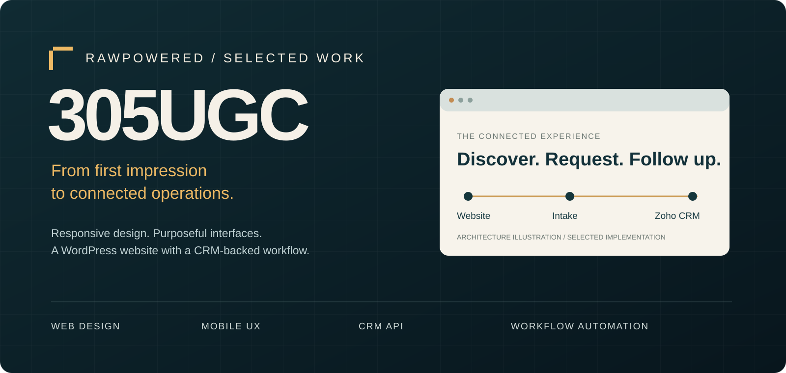

<a href="https://305undergroundconstruction.com">Visit the live website ↗</a> · <a href="#desktop-to-mobile">Web & mobile</a> · <a href="docs/SITE-PRESERVATION.md">Full-site screenshot archive</a> · <a href="#search-content-and-discovery">SEO & content</a> · <a href="#early-measured-results">Measured results</a> · <a href="#a-guided-product-tour">Product tour</a> · <a href="#how-the-system-fits-together">Architecture</a> · <a href="docs/SECURITY-PRACTICES.md">Security</a>

> **About the visuals:** website and quote-form captures show the public 305UGC site on October 24, 2026. PowerPortals workflow screens show an isolated shared-platform installation with fictional records. Operational acceptance is tracked separately in the [evidence notes](docs/PROJECT-STATUS.md).

## The brief

Give a Florida construction business a clear digital front door, then connect the next steps: describe the work, collect useful project context, organize follow-up, and provide appropriate customer and staff access.

The portfolio value is in the relationship between the design and the workflow. Service pages explain what the business does. Quote calls to action lead into a structured request. The portal architecture connects that request to the people and records needed to continue the work.

| Discipline | What this project demonstrates |
|:---|:---|
| Web design | Construction-focused visual hierarchy, service storytelling, selected project galleries, and consistent quote entry points |
| Mobile interface | Responsive typography, compact navigation, touch-sized actions, and vertically arranged content |
| Search & content | Twelve published guides, search and sharing metadata, structured data, and documented social scheduling |
| Product development | Guided project questions, service-specific branches, property context, and optional account enrollment |
| CRM integration | Shared server-side OAuth, governed API transport, field mapping, durable request identifiers, and scoped operational reads |
| Security engineering | Layered identity and record access, private response policies, protected documents, and separation of account and project approval |
| Problem solving | Local receipt preservation, retry-aware delivery, explicit authority boundaries, and evidence-based release gates |

## Desktop to mobile

The live website uses a restrained construction palette, large editorial headings, project imagery, and a clear request-a-quote action. At phone width, navigation becomes a menu and the content follows a single-column reading order.

<table><tr><th>Desktop · 1440 × 1000 viewport</th><th>Mobile · 390 × 844 viewport</th></tr><tr><td width="75%"><a href="assets/screenshots/305-desktop.png">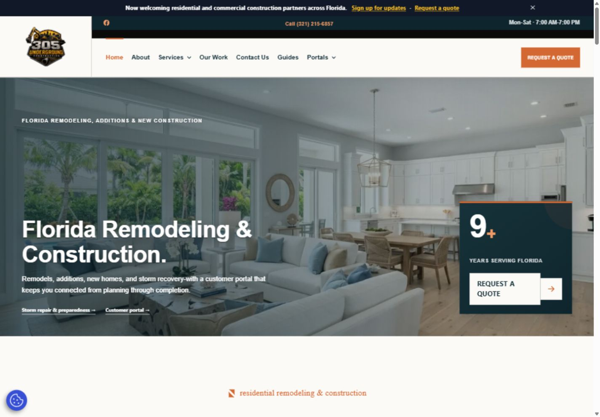</a></td><td width="25%"></td></tr></table>

*Actual public website · October 24, 2026. Select a capture to inspect it at full size.*

### Preserve the complete public-site walkthrough

The site-preservation archive records **58 public pages** across the site, articles, and portfolio, with nine key visitor paths captured at mobile width. Each entry opens a full-page image, preserving the visual experience page by page.

[Open the full-site screenshot walkthrough →](docs/SITE-PRESERVATION.md)

### Design decisions with a purpose

- **A clear first impression.** The opening message identifies remodeling, additions, and new construction, with direct paths to a quote, storm services, and customer access.
- **Depth behind the headline.** Service stories and project galleries let visitors move from broad capability to a concrete example of the work.
- **A repeatable next step.** Quote entry points appear throughout the experience, with the page of origin carried in the URL for context.
- **Continuity after the inquiry.** The website introduces customer access alongside the public-facing service story.

## The live 305UGC quote experience

The public quote page carries the company presentation into an eight-step project request. It opens with visual project choices and offers a full-form option. This capture shows the actual 305UGC interface, viewed anonymously on October 24 without entering customer information or submitting a request.

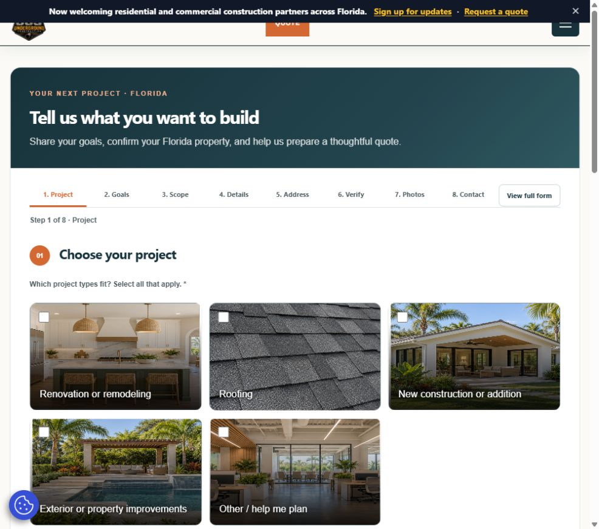

*Public rendering evidence only. Viewing the form does not verify remote delivery, invitation email, or the full CRM round trip.*

## Search, content and discovery

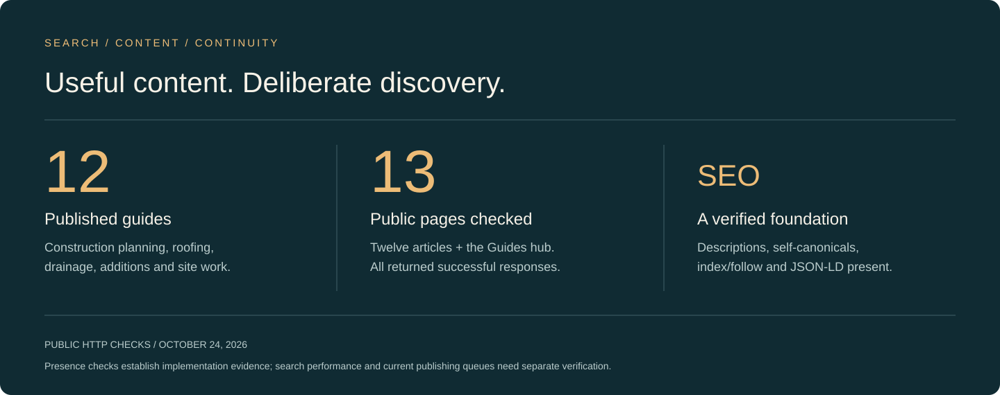

The SEO work extends beyond the homepage. **Twelve live guides** cover construction planning, roof comparisons, drainage, home additions, land clearing, demolition, paving, and storm preparation. The [Guides hub](https://305undergroundconstruction.com/guides/) gives that content a public entry point.

On October 24, all twelve articles and the hub returned HTTP 200 with descriptions, self-referencing canonicals, index/follow directives, and JSON-LD blocks. Original project records also document descriptive image filenames, alt text, titles, business/contact schema, and historical Buffer scheduling.

The October 11 homepage release aligned the SEO title, description and social preview with remodeling, construction and storm recovery. Live checks on October 24 confirmed self-canonical URLs, Open Graph metadata, LocalBusiness and nine-service OfferCatalog structured data, and a reachable XML sitemap index.

The homepage, quote page and customer portal also expose named controls and regions through ARIA, including `aria-label`, `aria-labelledby`, `aria-expanded`, and `aria-controls`. Quote and portal markup includes live-announcement regions; inspected pages include skip links and descriptive image alternatives. These details support accessibility intent and require behavioral testing to establish conformance.

Crawler work is documented precisely: `robots.txt` is present with a sitemap reference, but its portal exclusion grouping needs review. Replacement `llms.txt` and `bots.txt` files are prepared in the private 305UGC build; public deployment is pending. Portal noindex directives were independently observed. Search guidance does not replace access control.

The newest public article found is dated September 29. Continuing the editorial schedule, confirming future social delivery, and maintaining the measurement record remain follow-up work. The initial Analytics, Search Console and Facebook review is documented below. Backlink acquisition has not been substantiated by a campaign log or referring-domain report.

[Explore SEO, publishing history, crawler files and ARIA →](docs/SEO-ACCESSIBILITY-AND-DETAIL.md)

## Early measured results

The work now has an initial measurement record from **Google Analytics, Google Search Console and Facebook**, captured October 24. The first observed Facebook entries date to August 7; the focused blog and promotional push ran September 22–29. Later site SEO changes are annotated separately.

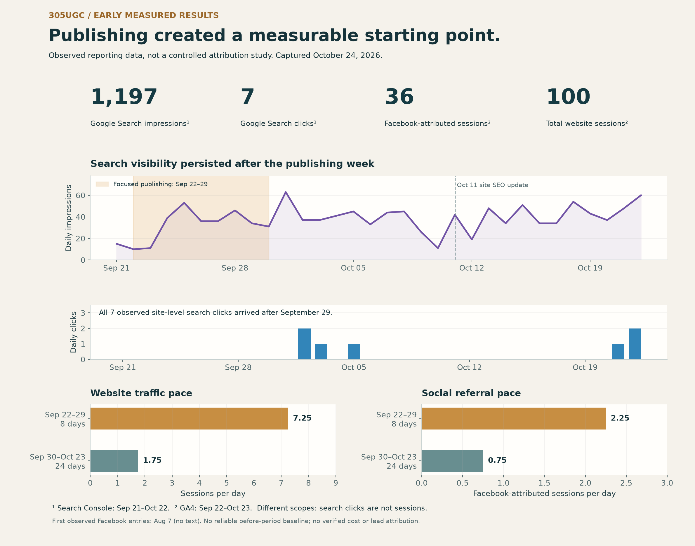

| Observed result | Reporting scope |
|:---|:---|
| **1,197 Google Search impressions · 7 clicks** | Search Console site totals, September 21–October 22 |
| **100 website sessions · 55 engaged sessions** | GA4, September 22–October 23; all reported sources |
| **36 Facebook-attributed sessions** | 35 tagged social sessions + 1 mobile Facebook referral |
| **11 article URLs with search exposure** | Inspected page table: 94 page-level impressions and 1 click; separate from site totals |

During the eight-day publishing push, GA4 recorded **58 sessions**. Over the following 24 days it recorded **42**: a lower daily traffic pace. Search visibility persisted, with all seven observed site-level search clicks arriving after September 29.

These are early, modest results rather than a proven ROI story. Earlier measurement coverage is insufficient for a reliable baseline, traffic exclusions and conversion tracking need validation, and later site work prevents attribution to publishing alone.

[Explore the timeline, comparisons and original report screenshots →](docs/MEASURED-RESULTS.md)

## A guided product tour

The following screens demonstrate the shared PowerPortals implementation with fictional records. They show interface work and interaction patterns without exposing production customer information.

### 01 / Start with the work the customer understands

A visual project selector introduces the request. The guided sequence separates project type, goals, scope, details, location, photos, and contact information. A full-form option supports visitors who prefer a different pace.

### 02 / Ask the next useful question

Service-specific questions collect scope in context. Roofing paths can distinguish material choices; location review brings the address and map together. Public parcel information supports review where source coverage is available.

<table><tr><th>Service-specific detail</th><th>Property context</th></tr><tr><td>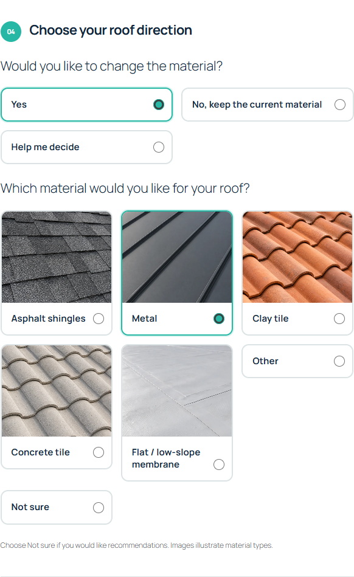</td><td>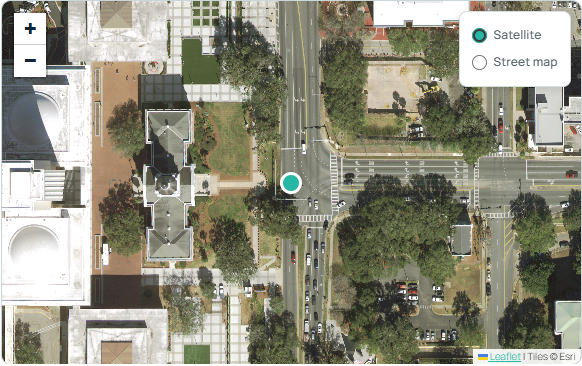</td></tr></table>

### 03 / Give each team a focused workspace

Sales filters help narrow an already authorized set of records. Project and field views organize different parts of the operational workflow. A filter improves navigation; it does not grant additional record access.

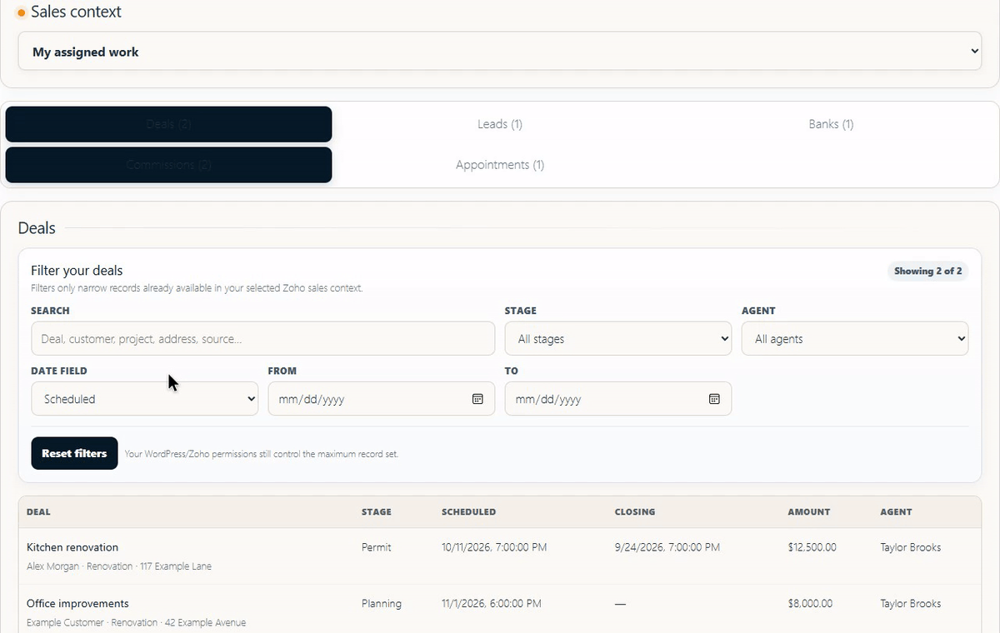

<strong>Explore project and field interfaces</strong>

#### Project workspace

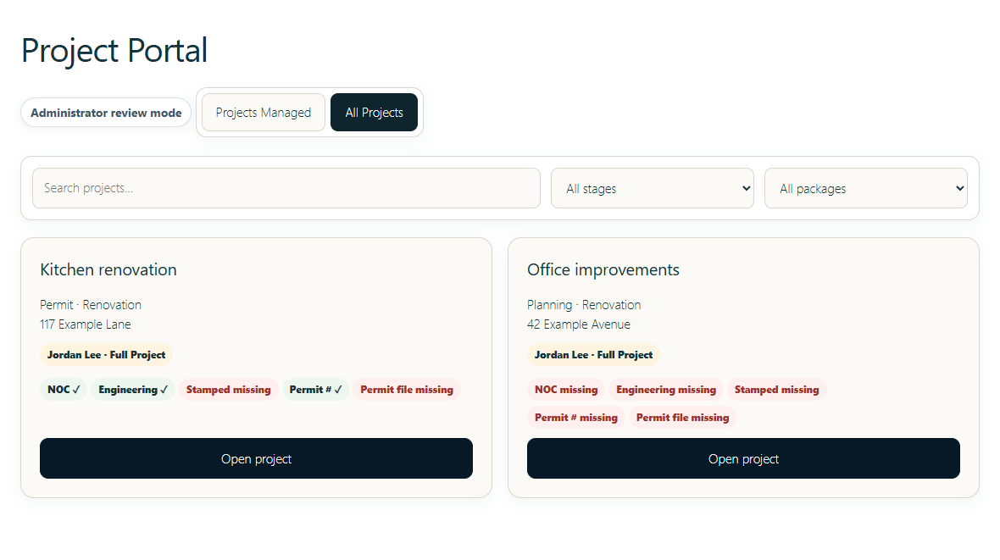

#### Field workspace

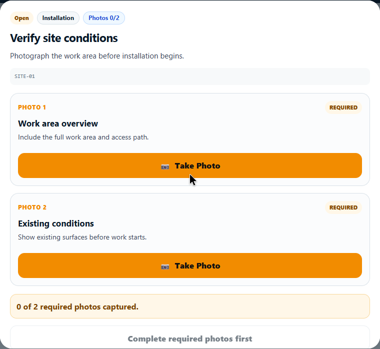

## How the system fits together

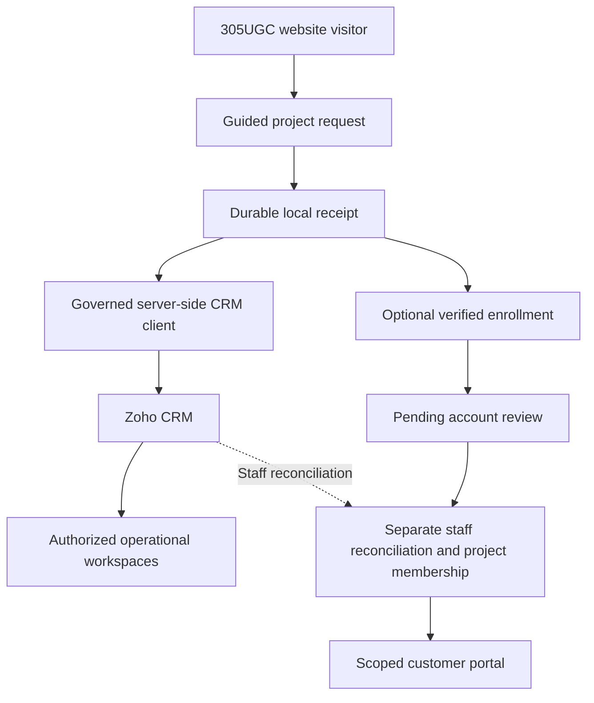

*This diagram describes the implementation architecture and its approval boundary. The complete live journey remains subject to acceptance testing; Lead conversion does not automatically grant customer project membership.*

## Automation as a problem-solving discipline

| Problem | Engineering approach | Why it matters |
|:---|:---|:---|
| A CRM delay should not erase a submitted request | Save a local receipt before remote delivery; use a retryable queue | Gives staff a durable reference when a remote service is unavailable |
| Retrying a delivery can create duplicate Leads | Use a stable request UUID and unique-key upsert | Makes the same logical request identifiable across delivery attempts |
| An email match does not establish record ownership | Verify enrollment and require explicit membership | Keeps convenience separate from authorization |
| An approved account is not necessarily an approved project | Keep account, request, and operational membership decisions independent | Supports returning customers without automatically exposing jobs |
| Remote API capacity is limited | Share a governed client with budgets, caching and circuit controls | Makes throttling an explicit workflow concern |
| Public property sources vary | Preserve provenance and permit review | Avoids treating a parcel suggestion as verified ownership |

[Read the CRM and automation walkthrough →](docs/CRM-AND-AUTOMATION.md)

## Security practices built into the approach

Identity, role checks, record scope, customer membership, and document release rules form separate layers. The implementation uses server-side CRM access and protects portal responses from shared caching on the paths checked in the October 16 review. The October 24 customer-portal response independently confirmed private/no-store caching, noindex/nofollow, and a no-referrer policy. Protected documents require authorization and a controlled release path. Website-level reviews also cover WordPress integrity, login/firewall tooling, hosting maintenance and recovery readiness, with remaining verification tracked separately.

Recorded maintenance work includes core integrity checks, login/firewall tooling, scoped anonymous access tests, and recovery requirements. Remaining acceptance and maintenance verification are tracked in the supporting notes.

[Explore the access and security approach →](docs/SECURITY-PRACTICES.md)

## Project delivery and verification

| Evidence category | What is established |
|:---|:---|
| Public website | Live desktop and mobile homepage captures on October 24; visible service content, quote entry points, gallery, and customer portal links |
| Search & content | Twelve published articles and the Guides hub checked October 24; historical SEO and social scheduling records reconciled separately |
| Reviewed deployment | October 16 review recorded deployed intake and portal components, working administrative CRM reads, and existing service requests with matching Zoho Cases |
| Demonstration media | Fictional-data intake, Sales, project, and field screens from an isolated shared-platform installation |
| Remaining acceptance | Controlled intake-to-Lead and invitation round trip, conversion handoff, ordinary-role workflows and revocation, capacity/retry recovery, isolated restore, and authorized signed-document release |

This portfolio presents implemented work and bounded verification. Initial search exposure and website traffic are documented above. Full live acceptance, attributable business gains, independent security assessment, and accessibility conformance require their own evidence. [Detailed evidence and status →](docs/PROJECT-STATUS.md)

---

<strong>Explore the work</strong> <a href="https://305undergroundconstruction.com">305UGC live website</a> · <a href="https://github.com/RawPowered/PowerPortals-Showcase">PowerPortals product showcase</a> · <a href="https://github.com/RawPowered">RawPowered</a>

This repository contains portfolio documentation and presentation media only. Production software, credentials, customer records, and installable packages are excluded. No software license is granted. WordPress and Zoho marks belong to their respective owners; no platform endorsement is implied.
