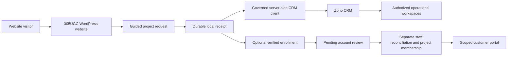

<strong>RAWPOWERED / SELECTED WORK</strong>

# 305UGC — Website & CRM Showcase

**From first impression to connected operations.**

A visual case study of the 305 Underground Construction website: responsive web design, guided project intake, focused team interfaces, and a WordPress–Zoho CRM integration built around the customer journey.

<a href="https://305undergroundconstruction.com">Visit the website ↗</a> · <a href="#desktop-to-mobile">Desktop & mobile</a> · <a href="#a-guided-product-tour">Product tour</a> · <a href="docs/CRM-AND-AUTOMATION.md">CRM & automation</a> · <a href="docs/SECURITY-PRACTICES.md">Security practices</a>

> **Evidence, clearly labeled.** Website screenshots were captured from the public 305UGC homepage and quote form on October 24, 2026. Shared-platform workflow screenshots are from an isolated PowerPortals test installation using fictional data, captured October 10; they are not live 305 customer records. The latest reviewed operational implementation evidence is dated October 16. Deployed components and configured integrations do not yet establish a fully accepted end-to-end customer journey. [Scope and verification →](docs/PROJECT-STATUS.md)

## The brief

Give a Florida construction business a clear digital front door, then connect the next steps: describe the work, collect useful project context, organize follow-up, and provide appropriate customer and staff access.

The portfolio value is in the relationship between the design and the workflow. Service pages explain what the business does. Quote calls to action lead into a structured request. The portal architecture connects that request to the people and records needed to continue the work.

| Discipline | What this project demonstrates |
|:---|:---|
| Web design | Construction-focused visual hierarchy, service storytelling, selected project galleries, and consistent quote entry points |
| Mobile interface | Responsive typography, compact navigation, touch-sized actions, and vertically arranged content |
| Product development | Guided project questions, service-specific branches, property context, and optional account enrollment |
| CRM integration | Shared server-side OAuth, governed API transport, field mapping, durable request identifiers, and scoped operational reads |
| Security engineering | Layered identity and record access, private response policies, protected documents, and separation of account and project approval |
| Problem solving | Local receipt preservation, retry-aware delivery, explicit authority boundaries, and evidence-based release gates |

## Desktop to mobile

The live website uses a restrained construction palette, large editorial headings, project imagery, and a clear request-a-quote action. At phone width, navigation becomes a menu and the content follows a single-column reading order.

<table><tr><th>Desktop · 1440 × 1000 viewport</th><th>Mobile · 390 × 844 viewport</th></tr><tr><td width="75%"></td><td width="25%"></td></tr></table>

*Actual public website captures, October 24, 2026. These show the rendered layouts at two viewport sizes; they are not performance, accessibility, or device-lab certifications.*

### Design decisions with a purpose

- **A clear first impression.** The opening message identifies remodeling, additions, and new construction, with direct paths to a quote, storm services, and customer access.
- **Depth behind the headline.** Service stories and project galleries let visitors move from broad capability to a concrete example of the work.
- **A repeatable next step.** Quote entry points appear throughout the experience, with the page of origin carried in the URL for context.
- **Continuity after the inquiry.** The website introduces customer access alongside the public-facing service story.

## The live 305UGC quote experience

The public quote page carries the company presentation into an eight-step project request. It opens with visual project choices and offers a full-form option. This capture shows the actual 305UGC interface, viewed anonymously on October 24 without entering customer information or submitting a request.

*Public rendering evidence only. Viewing the form does not verify remote delivery, invitation email, or the full CRM round trip.*

## A guided product tour

The following screens demonstrate the shared PowerPortals implementation with fictional records. They show interface work and interaction patterns without exposing production customer information.

### 01 / Start with the work the customer understands

A visual project selector introduces the request. The guided sequence separates project type, goals, scope, details, location, photos, and contact information. A full-form option supports visitors who prefer a different pace.

### 02 / Ask the next useful question

Service-specific questions collect scope in context. Roofing paths can distinguish material choices; location review brings the address and map together. Public parcel information supports review where source coverage is available.

<table><tr><th>Service-specific detail</th><th>Property context</th></tr><tr><td></td><td></td></tr></table>

### 03 / Give each team a focused workspace

Sales filters help narrow an already authorized set of records. Project and field views organize different parts of the operational workflow. A filter improves navigation; it does not grant additional record access.

<strong>Explore project and field interfaces</strong>

#### Project workspace

#### Field workspace

## How the system fits together

*This diagram describes the implementation architecture and its approval boundary. The complete live journey remains subject to acceptance testing; Lead conversion does not automatically grant customer project membership.*

## Automation as a problem-solving discipline

| Problem | Engineering approach | Why it matters |
|:---|:---|:---|
| A CRM delay should not erase a submitted request | Save a local receipt before remote delivery; use a retryable queue | Gives staff a durable reference when a remote service is unavailable |
| Retrying a delivery can create duplicate Leads | Use a stable request UUID and unique-key upsert | Makes the same logical request identifiable across delivery attempts |
| An email match does not establish record ownership | Verify enrollment and require explicit membership | Keeps convenience separate from authorization |
| An approved account is not necessarily an approved project | Keep account, request, and operational membership decisions independent | Supports returning customers without automatically exposing jobs |
| Remote API capacity is limited | Share a governed client with budgets, caching and circuit controls | Makes throttling an explicit workflow concern |
| Public property sources vary | Preserve provenance and permit review | Avoids treating a parcel suggestion as verified ownership |

[Read the CRM and automation walkthrough →](docs/CRM-AND-AUTOMATION.md)

## Security practices built into the approach

Identity, role checks, record scope, customer membership, and document release rules form separate layers. The implementation uses server-side CRM access and protects portal responses from shared caching on the paths checked in the October 16 review. Protected documents require authorization and a controlled release path.

Security is presented here as engineering practice backed by bounded checks, with additional acceptance work explicitly tracked. This portfolio does not claim an independent security audit, universal access-control coverage, or compliance certification.

[Explore the access and security approach →](docs/SECURITY-PRACTICES.md)

## Project delivery and verification

| Evidence category | What is established |
|:---|:---|
| Public website | Live desktop and mobile homepage captures on October 24; visible service content, quote entry points, gallery, and customer portal links |
| Reviewed deployment | October 16 review recorded deployed intake and portal components, working administrative CRM reads, and existing service requests with matching Zoho Cases |
| Demonstration media | Fictional-data intake, Sales, project, and field screens from an isolated shared-platform installation |
| Remaining acceptance | Controlled intake-to-Lead and invitation round trip, conversion handoff, ordinary-role workflows and revocation, capacity/retry recovery, isolated restore, and authorized signed-document release |

The project demonstrates a substantial implemented website and connected platform. The evidence does **not** yet support an unqualified “100% production complete” claim. [Detailed status →](docs/PROJECT-STATUS.md)

## Explore the work

[305UGC live website](https://305undergroundconstruction.com) · [PowerPortals product showcase](https://github.com/RawPowered/PowerPortals-Showcase) · [RawPowered](https://github.com/RawPowered)

This repository contains portfolio documentation and presentation media only. Production software, credentials, customer records, and installable packages are excluded. No software license is granted. WordPress and Zoho marks belong to their respective owners; no platform endorsement is implied.
