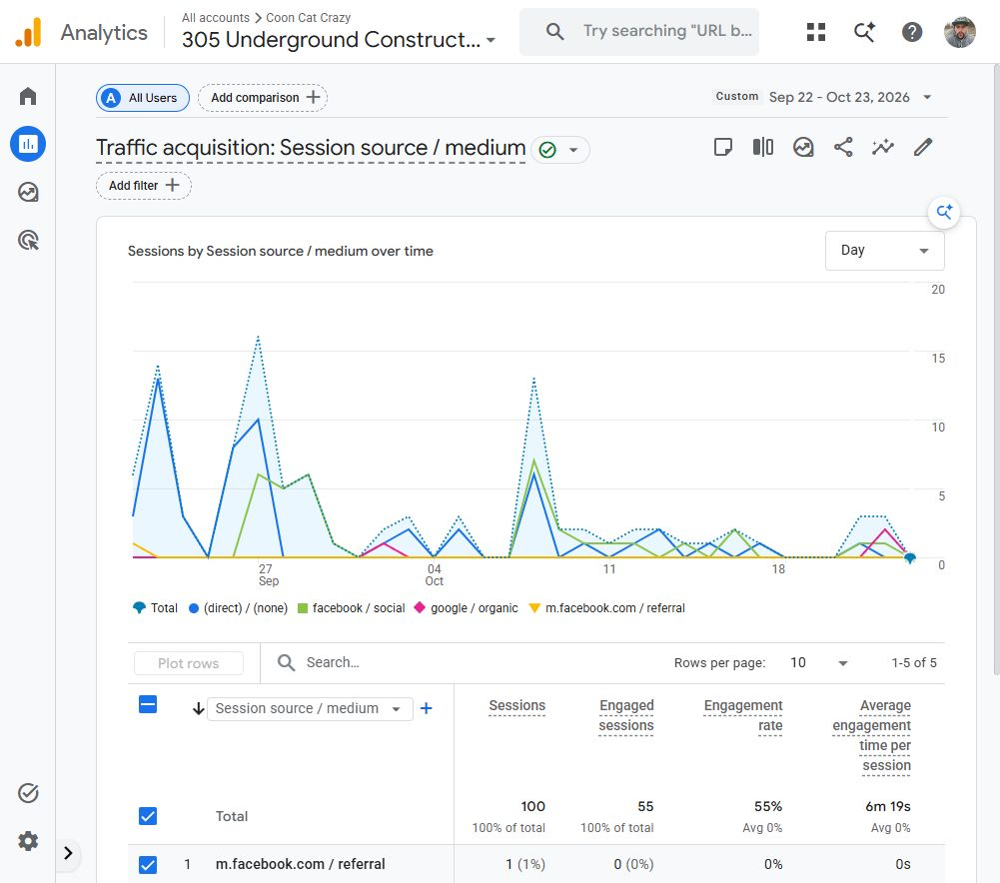
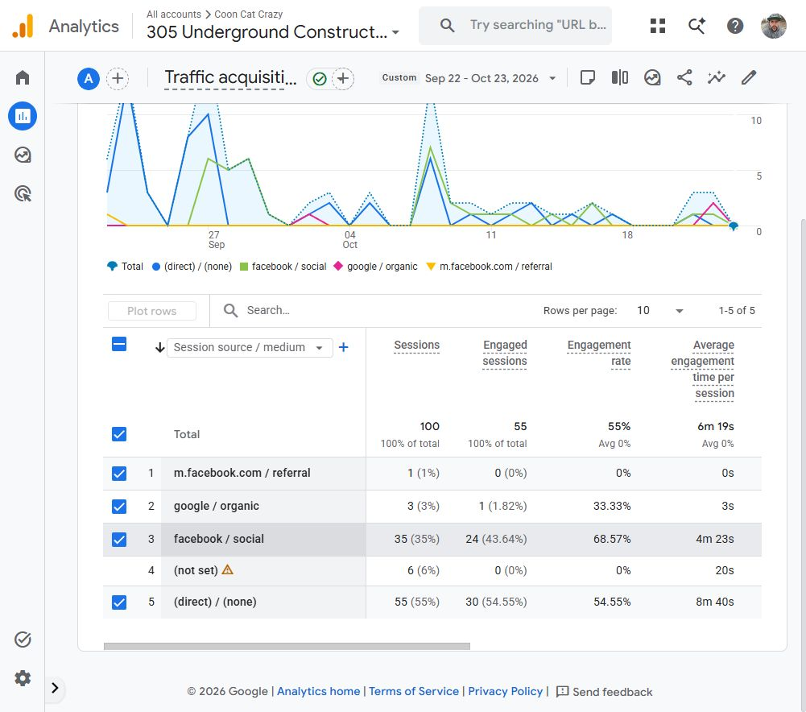
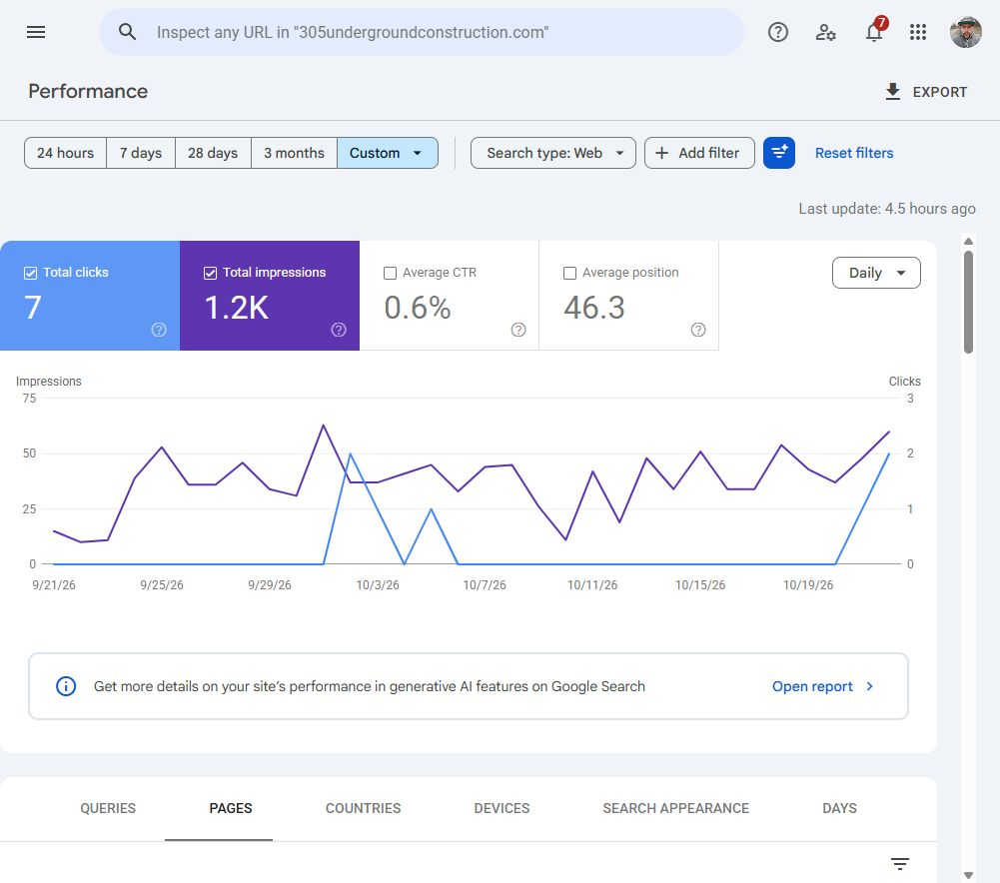
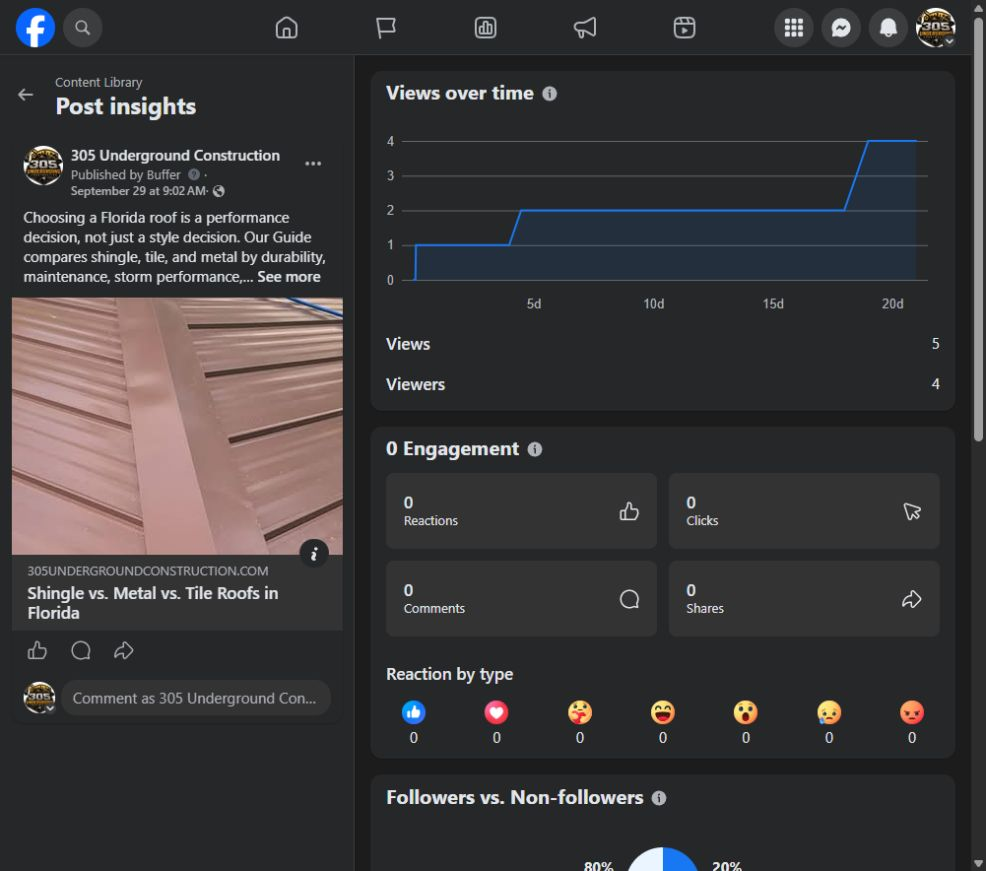

# Early measured results

[← Return to the showcase](../README.md)

**A short publishing effort produced observable early activity, with substantial room to grow.** This review connects the documented work to actual Google Analytics, Google Search Console and Facebook reporting, captured October 24, 2026. The figures below describe observed activity; they do not isolate the causal effect of SEO.

## Establishing the timeline

The owner's requested boundaries use the first and last blog/Facebook activity as approximate markers for the effort. The channels have different start dates, which remain visible rather than being collapsed into a misleading single launch day.

| Date | Observed milestone |
| --- | --- |
| **August 7** | Earliest Facebook entries observed in the Lifetime content view; both had no text content. These establish initial presence, not a substantive article campaign. |
| **September 22** | First published blog guide and first text-based service promotions observed in Facebook history. This begins the focused publishing interval. |
| **September 29** | Latest public blog publication and latest Facebook post observed: a roofing guide promotion published by Buffer. |
| **October 11** | A later homepage/storm SEO release. This remains a separate intervention after the content-publishing interval. |
| **October 24** | Reporting capture. Search Console's available daily history ended October 22; Analytics was measured through October 23. |

The first-to-last presence envelope is approximately **August 7–September 29**. The substantive article/promotion push is **September 22–29**. Deleted posts, unobserved activity, reporting timezones and historical availability can limit exactness. Facebook times are not converted into a claimed verified timezone.

## What the reports show

| Measurement | Observed value | Scope |
| --- | ---: | --- |
| Google Search impressions | **1,197** | Search Console, site/property aggregation, September 21–October 22 |
| Google Search clicks | **7** | Same scope and dates |
| Search CTR | **0.58%** | 7 ÷ 1,197; source interface rounds to 0.6% |
| Average search position | **46.3** | Source-reported site average, not a rank-improvement claim |
| Website sessions | **100** | GA4, all reported sources, September 22–October 23 |
| Engaged sessions | **55** | Same GA4 scope; 55% engagement rate |
| Facebook-attributed sessions | **36** | 35 `facebook / social` + 1 `m.facebook.com / referral` |
| Facebook-attributed engaged sessions | **24** | Combined source rows; 66.67% combined engagement rate |
| Google organic sessions | **3** | GA4 `google / organic`; distinct from Search Console clicks |
| Tracked key events | **0** | Displayed GA4 result; not proof that the business received no inquiries |

The remaining GA4 sources were Direct (55 sessions) and Unassigned (6). Internal/development traffic exclusions were not verified, so all 100 sessions must not be described as prospective customers. Sessions are not unique people.

### During publishing and afterward

| Measurement | Publishing: Sep 22–29 | Following period |
| --- | ---: | ---: |
| GA4 reporting days | 8 | 24 · Sep 30–Oct 23 |
| Website sessions | 58 | 42 |
| Sessions per day | **7.25** | **1.75** |
| Engaged sessions | 42 | 13 |
| Engagement rate | 72.41% | 30.95% |
| Facebook-attributed sessions | 18 | 18 |
| Facebook sessions per day | **2.25** | **0.75** |
| Search Console reporting days | 8 | 23 · Sep 30–Oct 22 |
| Search impressions | 265 | 917 |
| Search impressions per day | **33.13** | **39.87** |
| Search clicks | 0 | 7 |

Search Console additionally recorded 15 impressions and no clicks on September 21, reconciling to the 1,197-impression total. The two following-period columns intentionally have different end dates because the source reports had different complete-data coverage.

Daily website traffic was lower after publishing stopped, while Google Search visibility persisted. Search impressions per day were about 20% higher in the following period, and all seven observed site-level search clicks arrived after September 29. This is consistent with delayed discovery, but the sample is small and later site work, demand changes and measurement effects also matter. It is not a controlled demonstration that stopping or starting posts caused the changes.

## Evidence for the blog work itself

The Search Console Pages table included **11 of the 12 published article URLs**, with **94 page-level impressions and 1 page-level click** in the inspected window. The stormwater drainage guide recorded that click. Examples of article exposure include:

| Article | Page impressions | Page clicks |
| --- | ---: | ---: |
| Driveway paving guide | 19 | 0 |
| Land clearing before construction | 16 | 0 |
| Construction planning guide | 13 | 0 |
| Home-hardening guide | 12 | 0 |
| Stormwater drainage guide | 8 | 1 |

These are page-level report counts. Property totals and page totals use different aggregation and must not be summed or reconciled as though they were identical. The twelfth article's absence from the inspected table does not prove it was not indexed. Most site exposure in this window belonged to other pages, so the whole site's 1,197 impressions are not attributed to the blog campaign.

## What efficiency can—and cannot—mean here

The evidence supports an early effectiveness story: content was published, service-related searches generated exposure, Facebook delivered measurable website sessions, and search discovery continued beyond the publication week.

Financial or labor efficiency remains unmeasured. There are no verified cost/hour inputs, qualified-lead attribution or revenue records in this review. No ROI, cost-per-lead, time-saved or lead-generation guarantee is claimed. GA4's zero tracked key events and revenue fields are instrumentation outputs, not a business accounting statement.

The useful next measurement step is to validate inquiry-event tracking and internal-traffic exclusions, continue a documented editorial cadence, and compare matched reporting windows with a known baseline.

## Original report captures

### Google Analytics: the traffic trend

### Google Analytics: source and engagement evidence

### Google Search Console: search visibility and clicks

The requested filter began August 1, but the report supplied daily rows only for September 21–October 22. Missing earlier coverage is not filled with invented zeros.

### Facebook: the latest observed promotion

This individual post showed five views and four viewers at capture. Those figures are post-level counts, not campaign-wide totals or website sessions. The individual post's link-click insight was unavailable; GA4 referral sessions are reported separately.

## Measurement limits and reproducibility

- Analytics returned zero recorded sessions for August 7–September 21, but tracking coverage and installation history were not established. That is not a reliable zero-traffic baseline, and percentage growth from zero is not reported.
- Search Console supplied 32 daily rows; their sums reproduce 7 clicks and 1,197 impressions. Daily CTRs are not averaged to derive the aggregate CTR.
- GA4 active/following periods reconcile to 100 sessions and 55 engaged sessions. Facebook sources reconcile to 36 attributed sessions, rather than incorrectly treating 35 tagged sessions as the whole Facebook total.
- Source reporting dates and timezones are retained as displayed. No claim of exact cross-platform timestamp alignment is made.
- Search Console clicks, Analytics sessions and Facebook views are distinct measures with different collection and attribution rules.
- Raw account observations and exports remain outside this public repository. The [aggregate measurement record](../assets/results/measured-results.json) contains only the reviewed values and daily search series used for the chart. The chart is a derived visualization; the source screenshots above are authentic report captures.

Definitions: [Search Console Performance](https://support.google.com/webmasters/answer/7576553?hl=en), [GA4 Traffic acquisition](https://support.google.com/analytics/answer/12923437?hl=en).
